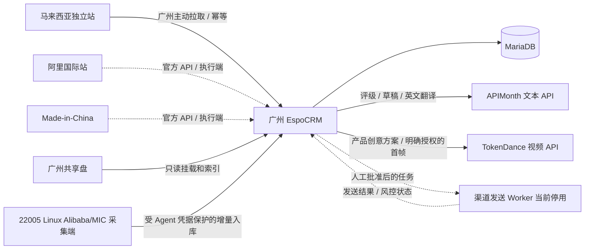

# 福三和外贸 CRM 与 AI 回复工作台

基于 EspoCRM 10.0.8 的外贸业务软件，使用一套五页 Web 工作台： 首页、消息中心、客户与评级、AI 工作中心、知识库。系统将外部询盘、客户匹配、知识资料、AI 回复草稿、人工审核、食品外贸业务记录和 22005 Linux 渠道采集端放在一个可审计的流程里。

**查找各分支的内容和合并状态，请先读 [GitHub 分支地图与开发交接](docs/BRANCH_GUIDE.md)。** 该文档逐一说明远端分支的用途、关键文件、历史验证记录和未完成事项。

**当前部署（2026-10-09）：CRM、Dify、Alibaba/MIC 抓取和 CRM bridge 均位于 22005 Linux；22001 原 Windows 系统已退役。** 入口为 `https://gzfusanhesp.com/`，部署路径、登录入口、备份与恢复见 [22005 迁移与运维记录](docs/MIGRATION_22001_TO_22005_2026-10-09.md)。消息中心已支持关联客户评级、右侧背调、评级排序和英文自动中文翻译。

**已标记的 Web 发布基线：[`crm-web-v1.1.0`](https://github.com/hanmin6/fsh/tree/crm-web-v1.1.0)，主分支为 `main`。** 首页显示 Made-in-China 与阿里国际站独立抓取状态；审核、身份确认、接管、交接和历史洞察均在同一工作台完成。新增 APIMonth 文本模型选择与 TokenDance 视频工作流，静态图片生成暂不启用。员工 CRM 正式域名规划为 `https://gzfusanhesp.com`，部署配置见 [CRM Web 部署手册](docs/CRM_WEB_DEPLOYMENT.md)。

**历史开发交接见 [2026-09-24 开发交接](docs/DEVELOPMENT_HANDOFF_2026-09-24.md)。** 它按日期列出已开发内容、验证边界、未完成任务和代码入口；[老板演示说明](docs/BOSS_DEMO.md)记录当前数据状态。旧交接文档是对应日期的历史快照。

当前环境默认禁止自动外发。`main` 已包含受独立 Agent 凭据保护的 Alibaba 入库端点、浏览器采集与增量同步代码，以及 Web 工作台里的历史客户只读看板；指定账号的真实全历史回填、来源完整性对账和真实发送尚未验收。Alibaba/MIC 当前平台登录已核验，Website/Email 等渠道仍使用占位连接器。食品外贸模块已完成实体、工作流、接口、布局和测试；当前生产模块启用情况见 [接入记录](docs/CRM_INTEGRATIONS_2026-10-02.md)，新安装的默认可见性由 Feature Flag 控制。

## 架构



- CRM 数据库位于本机 Docker volume，不放在 SMB 共享盘。
- `custom/` 和 `client/custom/` 直接从仓库挂载，全部二开可进行 Git 版本管理。
- 共享盘在生产部署时映射到 `KNOWLEDGE_BASE_PATH` 和 `MATERIAL_LIBRARY_PATH`；原始视频不提交给 AI。
- AI API Key、执行端 Token 和数据库密码只保存在服务端被 Git 忽略的环境文件，不进入前端构建产物。

## 已实现

- 8 个 EspoCRM 实体：渠道、会话、消息、AI 草稿、发送任务、知识文档、执行端、审计日志。
- CRM 与 AI 客服统一工作台、共享客户身份、人工身份确认、客服转销售、人工接管和上下文跳转；会话状态、销售阶段、发送任务状态分别维护。
- 统一询盘列表的渠道、负责人、状态、国家和未读字段，以及按最后消息时间排序的数据基础。
- 会话详情工作台：客户资料、消息时间线、AI 草稿编辑和人工批准区。评级从关联客户读取，右侧展示 AI 背调；会话默认按评级从高到低排序，英文消息自动显示中文译文并保存复用。
- 客户自动联网评级：五档价值等级、公司核实与来源证据，保留人工调整；后续新客户由原生定时任务处理。
- 客户匹配顺序：平台用户 ID、邮箱、手机号、公司加国家、姓名加公司；无法可靠匹配时保留待确认身份，必须由人工显式关联或建档。
- 消息、会话和发送任务的数据库唯一约束。
- 独立文本通道：GPT-6.1 Sol 使用 Responses，Grok 4.7 与 Gemini 3.8 Flash 使用 Chat Completions；手动选模、校验实际返回模型，真实通道失败不会回退 Mock。旧 AI_* 通道仅在新文本通道未启用且无新密钥时兼容。
- 独立视频通道：MiniMax H3 Max 视频生成、持久任务、后台核对、作品下载及私有素材权限；含糊提交进入人工核对，不盲目重提付费任务。静态图片生成关闭。
- PDF、DOCX、XLSX、TXT、Markdown 扫描和校验值更新。PDF 文本提取在容器存在 `pdftotext` 时启用。
- Alibaba、MadeInChina、Website、Email 的连接器骨架及可演示的 MockConnector。
- 执行端注册、心跳、任务领取、发送中、成功/失败回写、三次重试、领取超时、审计和每 Agent 独立凭据轮换。
- `POST /Fusanhe/alibaba/sync`：受 Agent capability 约束的 Alibaba 入库、回放冲突保护、身份/Lead 关联和消息去重；这不是完整的平台抓取执行端。
- Alibaba 采集端回填/增量代码与老板历史客户看板 `#Home/insights`：只读检索、规则建议、匿名信号分析、证据链接和来源 ID 对账；真实账号全量导入仍待验收。
- 全局停发开关，默认 `true`。
- “外贸运营概览”Dashlet，展示询盘、待回复、待审核、超时、负责人、响应时间、AI 修改率和发送结果。
- 老板、业务主管、业务员和平台执行端的权限基线；管理员使用 EspoCRM 内置管理员权限。
- 食品外贸业务模块：产品与规格版本、证书与检测报告、样品、询价、报价/PI、轻量销售订单和分批交付；每个模块有服务端状态机、权限保护、幂等或冻结规则及 Feature Flag。
- Android `1.0.0` UI 演示版已冻结为历史归档，不再作为当前 CRM 用户入口或持续开发目标。

## 目录

```text
custom/Espo/Custom/                 PHP、metadata、布局、API 路由
client/custom/src/                  EspoCRM 客户端工作台与 Dashlet
knowledge/demo/                     可提交的演示知识资料
materials/                          本地素材挂载点，不提交内容
scripts/bootstrap.py                幂等安装导航和角色
scripts/mock-agent.py               一次性模拟执行端
deploy/gateway-22005/               当前 Linux 采集端公开部署文件
docs/MIGRATION_22001_TO_22005_2026-10-09.md 当前部署与退役记录
scripts/backup.sh                   数据库和运行数据备份
scripts/restore.sh                  备份恢复（需明确传入备份目录）
docs/permissions.md                 角色权限说明
docs/API_AGENT_HANDOFF.md           接口开发交接与技术债
docs/PROJECT_STATUS.md              项目完成度与版本基线
docs/RELEASE_CRM_WEB_1.1.0.md         当前 Web 版本、验收边界与回退
docs/DEVELOPMENT_HANDOFF_2026-09-24.md  历史开发交接与未完成事项
docs/BOSS_DEMO.md                   老板历史客户演示与对账操作
docs/RELEASE_HANDOFF_2026-09-21.md  本次整合发布、验证、回退和分支说明
android-client/                     Android 1.0.0 历史归档（冻结）
```

## Spec-Driven Development

本仓库已在根目录接入 GitHub Spec Kit，Web、CRM API、Android 和执行端共用一套规格编号与工程宪章。

- 工程宪章：`.specify/memory/constitution.md`
- 当前全系统基线：`specs/001-system-baseline/`
- 当前特性指针：`.specify/feature.json`
- Codex 项目技能：`.agents/skills/speckit-*/`

新增功能、跨端契约变更、数据迁移和高风险修复都必须先建立独立特性目录，然后依次执行：

```text
$speckit-specify -> $speckit-clarify -> $speckit-plan -> $speckit-checklist
-> $speckit-tasks -> $speckit-analyze -> $speckit-implement -> $speckit-converge
```

小型变更可省略 clarify/checklist/analyze，但不得省略 specification、plan、tasks 和 convergence。
全系统基线是活契约，不代表其中所有目标已实现；未完成工作以
`specs/001-system-baseline/tasks.md` 为准。

在提交规格或代码前运行：

```bash
make spec-check
make verify-offline
```

## 启动和安装

```bash
cp .env.example .env
# 修改所有 change-me 值，并为 FUSANHE_AUTOMATION_TOKEN 生成长随机值
docker compose up -d
docker compose exec espocrm bin/command rebuild
set -a; source .env; set +a
python3 scripts/bootstrap.py
```

打开 <http://localhost:8080>。左侧导航包含 CRM、AI 客服、统一询盘、知识文档和发送任务；食品外贸实体是否显示由 `.env` 中的 Feature Flag 决定。老板看板可在首页添加 Dashlet“外贸运营概览”。

升级自定义代码后执行：

```bash
docker compose exec espocrm bin/command rebuild
```

## 环境变量

| 变量 | 用途 |
|---|---|
| `FUSANHE_TEXT_ENABLED` / `FUSANHE_TEXT_API_KEY` | 新文本通道开关和服务端密钥，默认关闭 |
| `FUSANHE_TEXT_API_BASE_URL` | APIMonth `/v1` 根地址 |
| `FUSANHE_TEXT_DEFAULT_MODEL` | 默认模型别名：`gpt`、`grok` 或 `gemini` |
| `FUSANHE_MEDIA_ENABLED` / `FUSANHE_MEDIA_API_KEY` | 视频通道开关和服务端密钥，默认关闭 |
| `FUSANHE_MEDIA_API_BASE_URL` / `FUSANHE_MEDIA_VIDEO_MODEL` | TokenDance 根地址与 `minimax-h3-max` |
| `FUSANHE_MEDIA_IMAGE_MODEL` | 本版保持为空，静态图片生成关闭 |
| `FUSANHE_MEDIA_MAX_DAILY_JOBS` / `FUSANHE_MEDIA_MAX_ACTIVE_JOBS` | 视频每日次数和并发任务上限 |
| `AI_API_BASE_URL` | 旧兼容通道的 OpenAI Compatible `/v1` 根地址 |
| `AI_API_KEY` | 旧兼容通道留空时使用 Mock AI；新真实通道不回退 Mock |
| `AI_MODEL` | 模型名 |
| `AI_TIMEOUT` / `AI_MAX_RETRIES` | 超时秒数和重试次数 |
| `KNOWLEDGE_BASE_PATH` | 容器内知识库目录 |
| `MATERIAL_LIBRARY_PATH` | 容器内素材目录 |
| `FUSANHE_AUTOMATION_TOKEN` | Agent 注册引导 Token；注册后改用单 Agent 凭证 |
| `FUSANHE_AGENT_CREDENTIAL_TTL_DAYS` | 单 Agent 凭证有效天数，默认 90 |
| `FUSANHE_AUTOMATION_LEGACY_UNTIL` | 旧共享 Token 临时兼容截止日；留空即禁用 |
| `FUSANHE_KNOWLEDGE_MAX_BYTES` | 单个知识文件最大字节数，默认 25 MiB |
| `FUSANHE_OUTBOUND_PAUSED` | 全局停发开关，生产初始化为 `true` |
| `ALIBABA_BRIDGE_URL` | Alibaba Bridge 地址 |
| `ALIBABA_BRIDGE_TOKEN` | Alibaba Bridge Token，不得提交到 Git |
| `FUSANHE_FEATURE_PRODUCTS` | 产品与规格模块开关，默认关闭 |
| `FUSANHE_FEATURE_CERTIFICATES` | 证书与检测报告模块开关，默认关闭 |
| `FUSANHE_FEATURE_SAMPLES` | 样品模块开关，默认关闭 |
| `FUSANHE_FEATURE_QUOTES` | 询价、报价和 PI 模块开关，默认关闭 |
| `FUSANHE_FEATURE_ORDERS` | 销售订单和分批交付模块开关，默认关闭 |

完整配置见 `.env.example`。修改双通道环境变量后使用 `docker compose up -d --force-recreate espocrm daemon`，使 Web 与后台任务都读取新值。

## Mock 演示

1. 管理员调用 `POST /api/v1/Fusanhe/mock/intake` 导入演示询盘。
2. 在“统一询盘”打开会话，点击“生成 AI 草稿”。
3. 修改草稿并点击“批准并创建发送任务”。
4. 保持 `FUSANHE_OUTBOUND_PAUSED=true` 时，执行端无法领取任务。
5. 仅在演示环境把开关改为 `false`，重建 CRM 容器后运行：

```bash
set -a; source .env; set +a
python3 scripts/mock-agent.py
```

6. 演示后立即恢复 `FUSANHE_OUTBOUND_PAUSED=true` 并重建 CRM 容器。

真实连接器不得直接复用网页选择器写进 CRM。接入优先级为官方 API、邮件或接口组合、浏览器自动化、Windows UI 自动化。

## Android 历史归档

Android 项目位于 `android-client/`，仅保留 `1.0.0` UI 演示快照，用于历史追溯，不纳入当前 CRM 产品入口和持续开发流程。

```bash
cd android-client
./gradlew testDebugUnitTest assembleDebug
```

历史功能、Mock 数据和接入方式见 `android-client/README.md` 与 `android-client/docs/BACKEND_API_MAPPING.md`。

## CRM Web 正式入口

员工通过 `https://gzfusanhesp.com` 使用 CRM。生产环境使用 EspoCRM 原生账号登录，Caddy 负责 HTTPS 和 WebSocket 入口，MariaDB、CRM、后台 daemon 和 WebSocket 服务运行在 CRM 服务器内部。独立站不属于本仓库本次 CRM 部署范围。

开发环境仍可使用 `http://localhost:8080`；复制 `.env.example` 做本地开发时，把
`CRM_DOMAIN`、`CRM_PUBLIC_ORIGIN`、`ESPOCRM_SITE_URL` 和
`ESPOCRM_WEBSOCKET_URL` 覆盖为 `localhost` 对应的 `http/ws` 地址。生产部署使用
`docker compose --profile edge --env-file /path/to/server.env up -d`，具体 DNS、证书、备份、
健康检查和回滚步骤见 `docs/CRM_WEB_DEPLOYMENT.md`。

## 备份与恢复

```bash
make backup
# 恢复会覆盖当前数据库，必须明确指定目录
./scripts/restore.sh backups/20260918-120000
```

备份包含 MariaDB dump、EspoCRM `data` volume 和当前 Git 提交信息。共享盘原始素材应使用广州文件服务器自己的快照与异地备份。

## 故障处理

```bash
docker compose ps
docker compose logs --tail=200 espocrm daemon websocket db
docker compose exec espocrm bin/command app-check
docker compose exec espocrm bin/command rebuild
```

- 页面没有新模块：运行 rebuild，强制刷新浏览器，再运行 `scripts/bootstrap.py`。
- AI 失败：检查 API 地址、Key、模型名、超时以及容器出网。
- 执行端领不到任务：检查全局停发开关、Token、任务是否已批准以及是否存在同会话活跃任务。
- 登录失效、验证码、页面变化或风控：执行端通过心跳上报，人工处理后再恢复发送。

## 已知限制

- 草稿与历史洞察仍使用匿名固定词表信号；消息自动翻译按权限读取待译消息正文并调用文本模型，详见 [翻译说明](docs/MESSAGE_AUTO_TRANSLATION_2026-10-09.md)。产品创意规划使用产品上下文与选定方案，首帧来源须明确确认；静态图片生成与自动对外发送未启用。
- Alibaba 与 Made-in-China 采集端及 CRM bridge 已在 22005 Linux 运行，平台登录状态已核验；真实账号全历史完整性、当前增量对账和持续观察仍需按业务证据验收。进程健康不代替消息历史完整性，真实平台发送未经生产验收。独立站和邮件仍是接口骨架。
- 平台登录桌面通过 22005 的 noVNC 与 SSH 转发访问，Windows 22001 已退役；当前不使用 Windows 桌面客户端读取方案。
- 食品外贸模块目前是 CRM 内的结构化业务记录与工作流，尚未连接 ERP、工厂排产、物流承运商或真实收付款系统；Feature Flag 只控制可见性，不替代权限。
- Android 1.0.0 仅作为历史 Mock 演示保留；当前用户入口统一为 CRM Web。
- DOCX/XLSX 使用轻量文本提取；复杂表格和扫描 PDF 后续应接专业解析/OCR 服务。
- 共享目录需使用当前 Linux 部署配置的知识库与素材路径，并保持只读权限；演示挂载不能替代生产数据与备份。
