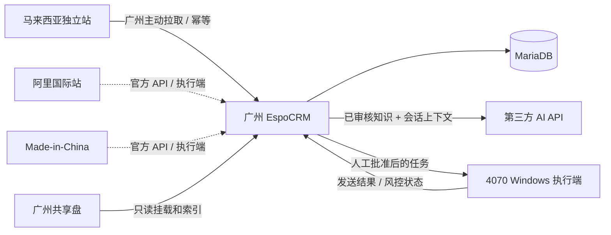

# 福三和外贸 CRM 与 AI 回复工作台

基于 EspoCRM 10.0.8 的外贸业务软件，包含两个并列入口：CRM 客户关系与销售推进、AI 客服统一收件与回复协作。系统将外部询盘、客户匹配、知识资料、AI 回复草稿、人工审核、食品外贸业务记录和广州 Windows 平台执行端放在一个可审计的流程里。

**查找各分支的内容和合并状态，请先读 [GitHub 分支地图与开发交接](docs/BRANCH_GUIDE.md)。** 该文档逐一说明远端分支的用途、关键文件、历史验证记录和未完成事项。

**接手项目先读 [2026-09-24 开发交接](docs/DEVELOPMENT_HANDOFF_2026-09-24.md)。** 它按日期列出已开发内容、验证边界、未完成任务和代码入口；[老板演示说明](docs/BOSS_DEMO.md)记录当前数据状态。旧交接文档是对应日期的历史快照。

`codex/web-workbench-hig` 分支的 Web 重构入口见 [shadcn/ui 工作台交接](docs/WEB_WORKBENCH_SHADCN_HANDOFF.md)；逐项通过状态以 [验收账本](specs/004-web-workbench-hig/verification.md) 和 [独立浏览器验收记录](docs/WEB_WORKBENCH_ACCEPTANCE_2026-09-24.md) 为准。该分支尚在开发，不代表 `main` 已部署新界面。

当前环境默认禁止自动外发。`main` 已包含受独立 Agent 凭据保护的 Alibaba 入库端点、浏览器采集与增量同步代码，以及 Web 工作台里的历史客户只读看板；指定账号的真实全历史回填、来源完整性对账和真实发送尚未验收。其他渠道使用占位连接器。食品外贸模块已完成实体、工作流、接口、布局和测试，默认通过 Feature Flag 隐藏。

## 架构



- CRM 数据库位于本机 Docker volume，不放在 SMB 共享盘。
- `custom/` 和 `client/custom/` 直接从仓库挂载，全部二开可进行 Git 版本管理。
- 共享盘在生产部署时映射到 `KNOWLEDGE_BASE_PATH` 和 `MATERIAL_LIBRARY_PATH`；原始视频不提交给 AI。
- AI API Key、执行端 Token 和数据库密码只保存在被 Git 忽略的 `.env`。

## 已实现

- 8 个 EspoCRM 实体：渠道、会话、消息、AI 草稿、发送任务、知识文档、执行端、审计日志。
- CRM 与 AI 客服双模块入口、共享客户身份、人工身份确认、客服转销售、人工接管和双向跳转；会话状态、销售阶段、发送任务状态分别维护。
- 统一询盘列表的渠道、负责人、状态、国家和未读字段，以及按最后消息时间排序的数据基础。
- 会话详情工作台：客户资料、消息时间线、AI 草稿编辑和人工批准区。
- 客户匹配顺序：平台用户 ID、邮箱、手机号、公司加国家、姓名加公司；无法可靠匹配时保留待确认身份，必须由人工显式关联或建档。
- 消息、会话和发送任务的数据库唯一约束。
- OpenAI Compatible Provider；未配置 Key 时使用确定性的 Mock AI。
- PDF、DOCX、XLSX、TXT、Markdown 扫描和校验值更新。PDF 文本提取在容器存在 `pdftotext` 时启用。
- Alibaba、MadeInChina、Website、Email 的连接器骨架及可演示的 MockConnector。
- 执行端注册、心跳、任务领取、发送中、成功/失败回写、三次重试、领取超时、审计和每 Agent 独立凭据轮换。
- `POST /Fusanhe/alibaba/sync`：受 Agent capability 约束的 Alibaba 入库、回放冲突保护、身份/Lead 关联和消息去重；这不是完整的平台抓取执行端。
- Alibaba 采集端回填/增量代码与老板历史客户看板 `#Home/insights`：只读检索、规则建议、匿名信号分析、证据链接和来源 ID 对账；真实账号全量导入仍待验收。
- 全局停发开关，默认 `true`。
- “外贸运营概览”Dashlet，展示询盘、待回复、待审核、超时、负责人、响应时间、AI 修改率和发送结果。
- 老板、业务主管、业务员和平台执行端的权限基线；管理员使用 EspoCRM 内置管理员权限。
- 食品外贸业务模块：产品与规格版本、证书与检测报告、样品、询价、报价/PI、轻量销售订单和分批交付；每个模块有服务端状态机、权限保护、幂等或冻结规则及 Feature Flag。
- Android `1.0.0` UI 演示版：客户新增、客户历史、询盘会话、翻译和 AI 回复建议；已有认证、远程仓库与 DTO 映射基础，完整生产接入仍未完成。

## 目录

```text
custom/Espo/Custom/                 PHP、metadata、布局、API 路由
client/custom/src/                  EspoCRM 客户端工作台与 Dashlet
knowledge/demo/                     可提交的演示知识资料
materials/                          本地素材挂载点，不提交内容
scripts/bootstrap.py                幂等安装导航和角色
scripts/mock-agent.py               一次性模拟 Windows 执行端
scripts/backup.sh                   数据库和运行数据备份
scripts/restore.sh                  备份恢复（需明确传入备份目录）
docs/permissions.md                 角色权限说明
docs/API_AGENT_HANDOFF.md           接口开发交接与技术债
docs/PROJECT_STATUS.md              项目完成度与版本基线
docs/DEVELOPMENT_HANDOFF_2026-09-24.md  最新开发交接与未完成事项
docs/BOSS_DEMO.md                   老板历史客户演示与对账操作
docs/RELEASE_HANDOFF_2026-09-21.md  本次整合发布、验证、回退和分支说明
android-client/                     Android 1.0.0 UI 演示版
```

## Spec-Driven Development

本仓库已在根目录接入 GitHub Spec Kit，Web、CRM API、Android 和执行端共用一套规格编号与工程宪章。

- 工程宪章：`.specify/memory/constitution.md`
- 当前全系统基线：`specs/001-system-baseline/`
- 当前特性指针：`.specify/feature.json`
- Codex 项目技能：`.agents/skills/speckit-*/`

新增功能、跨端契约变更、数据迁移和高风险修复都必须先建立独立特性目录，然后依次执行：

```text
$speckit-specify -> $speckit-clarify -> $speckit-plan -> $speckit-checklist
-> $speckit-tasks -> $speckit-analyze -> $speckit-implement -> $speckit-converge
```

小型变更可省略 clarify/checklist/analyze，但不得省略 specification、plan、tasks 和 convergence。
全系统基线是活契约，不代表其中所有目标已实现；未完成工作以
`specs/001-system-baseline/tasks.md` 为准。

在提交规格或代码前运行：

```bash
make spec-check
make verify-offline
```

## 启动和安装

```bash
cp .env.example .env
# 修改所有 change-me 值，并为 FUSANHE_AUTOMATION_TOKEN 生成长随机值
docker compose up -d
docker compose exec espocrm bin/command rebuild
set -a; source .env; set +a
python3 scripts/bootstrap.py
```

打开 <http://localhost:8080>。左侧导航包含 CRM、AI 客服、统一询盘、知识文档和发送任务；食品外贸实体是否显示由 `.env` 中的 Feature Flag 决定。老板看板可在首页添加 Dashlet“外贸运营概览”。

升级自定义代码后执行：

```bash
docker compose exec espocrm bin/command rebuild
```

## 环境变量

| 变量 | 用途 |
|---|---|
| `AI_API_BASE_URL` | OpenAI Compatible `/v1` 根地址 |
| `AI_API_KEY` | 留空时使用 Mock AI |
| `AI_MODEL` | 模型名 |
| `AI_TIMEOUT` / `AI_MAX_RETRIES` | 超时秒数和重试次数 |
| `KNOWLEDGE_BASE_PATH` | 容器内知识库目录 |
| `MATERIAL_LIBRARY_PATH` | 容器内素材目录 |
| `FUSANHE_AUTOMATION_TOKEN` | Agent 注册引导 Token；注册后改用单 Agent 凭证 |
| `FUSANHE_AGENT_CREDENTIAL_TTL_DAYS` | 单 Agent 凭证有效天数，默认 90 |
| `FUSANHE_AUTOMATION_LEGACY_UNTIL` | 旧共享 Token 临时兼容截止日；留空即禁用 |
| `FUSANHE_KNOWLEDGE_MAX_BYTES` | 单个知识文件最大字节数，默认 25 MiB |
| `FUSANHE_OUTBOUND_PAUSED` | 全局停发开关，生产初始化为 `true` |
| `ALIBABA_BRIDGE_URL` | Alibaba Bridge 地址 |
| `ALIBABA_BRIDGE_TOKEN` | Alibaba Bridge Token，不得提交到 Git |
| `FUSANHE_FEATURE_PRODUCTS` | 产品与规格模块开关，默认关闭 |
| `FUSANHE_FEATURE_CERTIFICATES` | 证书与检测报告模块开关，默认关闭 |
| `FUSANHE_FEATURE_SAMPLES` | 样品模块开关，默认关闭 |
| `FUSANHE_FEATURE_QUOTES` | 询价、报价和 PI 模块开关，默认关闭 |
| `FUSANHE_FEATURE_ORDERS` | 销售订单和分批交付模块开关，默认关闭 |

修改环境变量后使用 `docker compose up -d --force-recreate espocrm` 使 Apache 进程读取新值。

## Mock 演示

1. 管理员调用 `POST /api/v1/Fusanhe/mock/intake` 导入演示询盘。
2. 在“统一询盘”打开会话，点击“生成 AI 草稿”。
3. 修改草稿并点击“批准并创建发送任务”。
4. 保持 `FUSANHE_OUTBOUND_PAUSED=true` 时，执行端无法领取任务。
5. 仅在演示环境把开关改为 `false`，重建 CRM 容器后运行：

```bash
set -a; source .env; set +a
python3 scripts/mock-agent.py
```

6. 演示后立即恢复 `FUSANHE_OUTBOUND_PAUSED=true` 并重建 CRM 容器。

真实连接器不得直接复用网页选择器写进 CRM。接入优先级为官方 API、邮件或接口组合、浏览器自动化、Windows UI 自动化。

## Android 客户端

Android 项目位于 `android-client/`。当前版本为 `1.0.0` UI 演示版，使用 Kotlin、Jetpack Compose、Material 3、Hilt、StateFlow、Room 占位和 Retrofit 占位。

```bash
cd android-client
./gradlew testDebugUnitTest assembleDebug
```

Android 已具备部分真实 API 接入基础，但尚未完成生产环境端到端验收。详细功能、Mock 数据和接入方式见 `android-client/README.md` 与 `android-client/docs/BACKEND_API_MAPPING.md`。

## 备份与恢复

```bash
make backup
# 恢复会覆盖当前数据库，必须明确指定目录
./scripts/restore.sh backups/20260918-120000
```

备份包含 MariaDB dump、EspoCRM `data` volume 和当前 Git 提交信息。共享盘原始素材应使用广州文件服务器自己的快照与异地备份。

## 故障处理

```bash
docker compose ps
docker compose logs --tail=200 espocrm daemon websocket db
docker compose exec espocrm bin/command app-check
docker compose exec espocrm bin/command rebuild
```

- 页面没有新模块：运行 rebuild，强制刷新浏览器，再运行 `scripts/bootstrap.py`。
- AI 失败：检查 API 地址、Key、模型名、超时以及容器出网。
- 执行端领不到任务：检查全局停发开关、Token、任务是否已批准以及是否存在同会话活跃任务。
- 登录失效、验证码、页面变化或风控：执行端通过心跳上报，人工处理后再恢复发送。

## 已知限制

- Alibaba CRM 入库、浏览器采集和增量同步代码已具备，合成数据及隔离运行时验证通过；当前真实账号全历史回填、完整性对账和实际页面适配尚未验收。OAuth Bridge 健康检查通过不等于消息历史可读。真实平台发送代码未经生产验收。Made-in-China、独立站和邮件仍是接口骨架。
- 既有 Alibaba 浏览器执行端尚未在用户指定的“福三和主机”找到可复用安装，也未确认当前登录入口；Windows 桌面客户端读取方案尚未实现。
- 食品外贸模块目前是 CRM 内的结构化业务记录与工作流，尚未连接 ERP、工厂排产、物流承运商或真实收付款系统；Feature Flag 只控制可见性，不替代权限。
- Android 1.0.0 有 Mock 演示及部分真实 API 基础；WebSocket、完整离线同步、正式签名发布和生产端到端验收尚未完成。
- DOCX/XLSX 使用轻量文本提取；复杂表格和扫描 PDF 后续应接专业解析/OCR 服务。
- 当前共享目录为本地演示挂载，部署到广州 Windows 时需替换为实际共享盘路径并配置只读权限。
