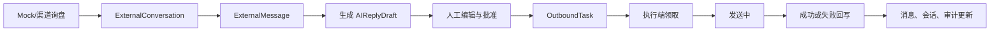

# 福三和 CRM 接口开发交接文档

更新时间：2026-09-18
目标分支：`codex/fusanhe-crm-frontend`
技术底座：EspoCRM `10.0.8-apache`、MariaDB `11.4`、PHP、Docker Compose

### 2026-09-19 状态更新

本轮已完成并验证：

- 修复首次新客户入库时 `needsManualMatch` 的变量引用错误。
- `GET /Fusanhe/dashboard` 已改为只读计算。
- 新增只读 `GET /Fusanhe/status`，返回停发、渠道健康和 Agent 数量摘要。
- Agent 领取任务前会校验注册、在线状态和渠道能力。
- 成功回写必须提供 `platformMessageId`；已发送任务的重复成功回写按幂等请求处理。
- Alibaba Bridge 已实现只读健康检查；没有配置 Token 时返回 `configured: false`。
- CRM 入库端点 `POST /Fusanhe/alibaba/sync` 和每 Agent 独立凭据已实现，包含 capability 校验、受限批次校验、幂等回放与审计。

### 2026-09-22 状态更新（Alibaba 历史消息同步与时序对齐）

本轮已完成并验证：

- **Alibaba 消息同步基座（Message Sync Foundation）全链路联调闭环**：
  - 采集端（`alibb`）与 CRM 入库端点（`POST /Fusanhe/alibaba/sync`）全链路贯通，实现了分批入库、断点续传、自动建联与线索关联。
  - **修复侧边栏挂件噪音污染**：采集器过滤右侧挂件与 Tab 页容器，彻底剔除“未读人脉”、“快速锁定主推款”等非聊天文本，恢复真实的最新消息摘要（`lastMessagePreview`）。
  - **修复时区与时间戳错乱**：原始北京时间在入库时统一归一化为标准 UTC 存储，消除 8 小时显示漂移；针对低置信度时间采用相对偏移算法，杜绝 `00:00:00` 午夜碰撞。
  - **保障工作台绝对保序**：工作台详情页（`detail.js`）查询改为按 `sourceSequence ASC` 严格保序呈现，解决同分钟多气泡排序紊乱。
  - **补齐脱敏 Fixtures 与端到端自动化测试**：新增 `tests/fixtures/alibaba_conversations.json`、`tests/fixtures/alibaba_history_13907077489.json` 以及 `tests/test_sync_e2e.py`，双端测试全部通过（alibb 51/51，CRM runtime 7/7）。

仍未完成：业务接口细粒度 ACL、Alibaba 真实外发执行端、其他渠道连接器；保持 `FUSANHE_OUTBOUND_PAUSED=true`。

## 1. 可直接发给接手 Agent 的提示词

```text
你现在接手“福三和外贸 CRM 与 AI 回复工作台”的接口开发。

代码仓库当前应位于分支 codex/fusanhe-crm-frontend。开始前先阅读：
1. docs/API_AGENT_HANDOFF.md
2. README.md
3. custom/Espo/Custom/Resources/routes.json
4. custom/Espo/Custom/Tools/Fusanhe/WorkflowService.php
5. custom/Espo/Custom/Tools/Fusanhe/Connector/Connector.php
6. client/custom/res/fusanhe/FRONTEND.md

系统基于 EspoCRM 10.0.8，已经完成统一询盘、消息、AI 草稿、人工批准、发送任务、执行端领取与结果回写的 Mock 闭环，也完成了前端工作台。真实 Alibaba、Made-in-China、独立站和邮件连接器仍未实现，Windows 平台执行端也只有一次性 Mock 脚本。

你的任务是接手并完善接口层。先修复交接文档列出的 P0 缺陷，再建设生产可用的渠道接入和执行端 API。保持 FUSANHE_OUTBOUND_PAUSED=true，不进行真实外发。不要修改 EspoCRM core/vendor，不提交密码、Token、Cookie 或客户数据。

工作要求：
- 先检查现有实现和测试，不要重写已经工作的实体、页面或流程。
- 为接口补充明确的请求校验、ACL、幂等、状态机约束、错误码和审计。
- 真实渠道优先使用官方 API；如果缺少平台凭证或 API 文档，完成 connector、配置、测试替身和待接入清单，不伪造“已接通”。
- 执行端接口要升级为可轮换的单 Agent 凭证，验证 Agent 注册状态、能力和任务渠道。
- 所有 GET 接口必须无副作用；Dashboard 改为只读聚合，并新增只读运行状态接口。
- 新增测试必须覆盖新会话入库、重复消息、权限拒绝、并发领取、领取过期、失败重试、重复结果回写和停发开关。
- 修改后执行 rebuild、app-check、PHP lint、契约测试和运行时测试，并更新本交接文档或新增 API 文档。

完成时请报告：修改文件、接口契约变化、数据库或 metadata 变化、验证结果、仍需的外部凭证和未完成风险。
```

## 2. 项目现在做到什么程度

仓库已经有一套可运行的 CRM MVP，共约 153 个文件、7,500 行新增代码。当前闭环是：



已经实现：

- Docker Compose 本地环境：MariaDB、EspoCRM、daemon、websocket。
- 8 个自定义实体及中英文布局和字典。
- 询盘入库、消息去重、客户匹配和待确认 Lead 创建。
- AI 草稿生成，支持 OpenAI Compatible API；没有 Key 时使用确定性 Mock。
- 人工批准后创建幂等发送任务。
- 执行端注册、心跳、领取、发送中和结果回写。
- 领取超时恢复、最多三次失败重试、同一会话避免并行发送。
- 全局停发开关，默认 `FUSANHE_OUTBOUND_PAUSED=true`。
- 知识文件扫描：PDF、DOCX、XLSX、TXT、Markdown。
- 运营统计、自动化审计、角色权限基线。
- 统一询盘、客户、草稿、知识库、发送任务、执行端和首页前端。
- 备份、恢复、初始化角色、Mock Agent 和测试脚本。

当前 Docker 验证结果：4 个容器 healthy，rebuild 和 app-check 通过，全部自定义 PHP lint 通过，7 个实体 REST 接口返回 200，5 项契约测试和 2 项运行时闭环测试通过。

## 3. 代码入口

| 路径 | 用途 |
|---|---|
| `custom/Espo/Custom/Resources/routes.json` | 自定义 API 路由 |
| `custom/Espo/Custom/Tools/Fusanhe/Api/` | API Action 类 |
| `custom/Espo/Custom/Tools/Fusanhe/WorkflowService.php` | 询盘、草稿、任务和统计业务逻辑 |
| `custom/Espo/Custom/Tools/Fusanhe/AiProvider.php` | AI Provider 和 Mock AI |
| `custom/Espo/Custom/Tools/Fusanhe/KnowledgeScanner.php` | 知识文件扫描与文本提取 |
| `custom/Espo/Custom/Tools/Fusanhe/AutomationAuth.php` | 执行端 Token 校验 |
| `custom/Espo/Custom/Tools/Fusanhe/Connector/` | 渠道接口和占位实现 |
| `custom/Espo/Custom/Resources/metadata/entityDefs/` | 实体字段、枚举和索引 |
| `client/custom/src/views/` | 调用接口的前端工作台 |
| `scripts/mock-agent.py` | 一次性执行端模拟器 |
| `scripts/bootstrap.py` | 导航和角色初始化 |
| `tests/test_contracts.py` | 离线契约测试 |
| `tests/verify_runtime.py` | 已有数据闭环验证 |

## 4. 数据模型

### ExternalChannel

渠道配置。类型包括 `Alibaba`、`MadeInChina`、`Website`、`Email`、`WhatsApp`、`Other`。目前真实渠道均为占位实现。

关键字段：`type`、`enabled`、`connectionStatus`、`lastSyncAt`、`config`。

### ExternalConversation

统一询盘会话，关联渠道、Account、Contact 或 Lead。

状态：

```text
new -> pending -> waitingApproval -> readyToSend -> sending -> sent
                                                    \-> failed
任意业务结束状态可进入 closed
```

关键字段：`channelId`、`externalId`、`externalUserId`、`status`、`unreadCount`、`lastInboundAt`、`lastOutboundAt`、`firstResponseMinutes`、`slaBreached`。

唯一索引：`channelId + externalId`。

### ExternalMessage

收发消息。方向为 `inbound` 或 `outbound`。

关键字段：`conversationId`、`externalId`、`direction`、`body`、`attachmentMetadata`、`deliveryStatus`、`rawPayload`、`contentHash`。

唯一索引：`conversationId + contentHash`。

### AIReplyDraft

AI 回复草稿和人工审核记录。

状态：`generated`、`edited`、`approved`、`rejected`、`sent`。

关键字段：`draftText`、`intent`、`summaryZh`、`suggestedLanguage`、`missingInformation`、`confidence`、`riskLevel`、`citedKnowledge`、`approvedById`、`approvedAt`。

### OutboundTask

批准后生成的外发任务。

状态：`pending`、`claimed`、`sending`、`sent`、`failed`、`cancelled`。

关键字段：`idempotencyKey`、`claimedBy`、`claimExpiresAt`、`retryCount`、`errorMessage`、`platformMessageId`、`payload`。

唯一索引：`idempotencyKey`。

### KnowledgeDocument

知识资料索引。审批状态为 `draft`、`approved`、`expired`。只有 `approved` 文档会送入 AI 上下文。

### AutomationAgent

Windows 或浏览器执行端登记和心跳状态。状态包括 `online`、`offline`、`loginExpired`、`captcha`、`pageChanged`、`riskControl`。

### AutomationAudit

记录 intake、草稿生成、批准、Agent 注册、心跳、领取、发送中和结果回写事件。

## 5. 已有自定义接口

API 前缀为 `/api/v1`。普通业务接口使用 EspoCRM 登录认证；执行端接口使用请求头：

```http
X-Automation-Token: <FUSANHE_AUTOMATION_TOKEN>
Content-Type: application/json
```

### `POST /Fusanhe/mock/intake`

用途：模拟或适配器写入一条外部询盘。

必填请求字段：

```json
{
  "conversationExternalId": "CONV-001",
  "messageExternalId": "MSG-001",
  "body": "Customer message"
}
```

可选字段：`channelType`、`subject`、`externalUserId`、`senderName`、`company`、`email`、`phone`、`country`、`language`、`product`、`sentAt`。

响应：`deduplicated`、`conversationId`、`messageId`、`createdLead`。

副作用：可能创建渠道、Lead、会话、消息和审计记录，并更新会话未读数及最后消息字段。

### `POST /Fusanhe/conversation/:id/generate-draft`

用途：读取最近 20 条消息和最多 5 条已审核知识，调用 AI 生成草稿。

响应包含：`draftId`、`intent`、`summaryZh`、`suggestedLanguage`、`draftText`、`riskLevel`、`confidence`、`missingInformation`、`citedKnowledge`、`provider`、`model`。

副作用：创建 `AIReplyDraft`，会话状态改为 `waitingApproval`，写审计。

### `POST /Fusanhe/draft/:id/approve`

请求：

```json
{
  "draftText": "Optional edited final text"
}
```

管理员或有 `OutboundTask:create` 权限的用户可调用。创建或复用幂等 `OutboundTask`，并把草稿改为 `approved`、会话改为 `readyToSend`。

响应：`taskId`、`idempotencyKey`、`deduplicated`。

### `POST /Fusanhe/agent/register`

认证头：引导注册使用 `X-Automation-Token`（Bootstrap Token）。
Agent 凭证认证：注册后生成每个 Agent 的专属凭据，后续请求必须通过请求头携带 `X-Agent-Key` 与 `X-Agent-Token`。
环境配置：客户端通过环境变量 `FUSANHE_AGENT_TOKEN` 复用最后一次成功轮换的凭据；需要主动更新或轮换时设置 `FUSANHE_ROTATE_AGENT_TOKEN=1`。

请求：

```json
{
  "agentKey": "guangzhou-agent-01",
  "name": "广州执行端",
  "capabilities": ["Alibaba", "MadeInChina"],
  "rotateCredential": true
}
```

响应：`agentId`、`status`、`agentToken`、`credentialIssued`。

### `POST /Fusanhe/agent/heartbeat`

请求：`agentKey`、可选 `status`、可选 `lastError`。响应：`{"ok": true}`。

### `POST /Fusanhe/agent/claim`

请求：`{"agentKey":"guangzhou-agent-01"}`。

如果全局停发，响应：

```json
{"task": null, "paused": true}
```

否则领取最早的 pending 任务，锁定 5 分钟。任务包含 `id`、`idempotencyKey`、`conversationId`、`channelId`、`body`、`claimExpiresAt`。

### `POST /Fusanhe/agent/task/:id/sending`

请求：`{"agentKey":"guangzhou-agent-01"}`。任务必须已经被该 Agent 领取。

### `POST /Fusanhe/agent/task/:id/result`

成功请求：

```json
{
  "agentKey": "guangzhou-agent-01",
  "success": true,
  "platformMessageId": "PLATFORM-MSG-ID"
}
```

失败请求：

```json
{
  "agentKey": "guangzhou-agent-01",
  "success": false,
  "errorMessage": "send failed"
}
```

成功时创建 outbound 消息并更新草稿、任务和会话；失败时重试计数加一，前两次回到 pending，第三次进入 failed。

### `GET /Fusanhe/dashboard`

返回今日询盘、渠道和负责人分布、待回复、待审核、SLA、平均首响、AI 修改率、发送成功率和失败任务。

当前实现会在 GET 中更新 `waitingMinutes` 和 `slaBreached`，必须改成纯只读或把刷新拆成后台任务。

### `POST /Fusanhe/knowledge/scan`

扫描 `KNOWLEDGE_BASE_PATH`，按路径和 SHA-256 更新 `KnowledgeDocument`。新文档默认为 `draft`。

## 6. EspoCRM 原生 REST 接口

所有自定义实体也可使用 EspoCRM 标准 REST：

```text
GET    /api/v1/ExternalConversation
GET    /api/v1/ExternalConversation/:id
POST   /api/v1/ExternalConversation
PATCH  /api/v1/ExternalConversation/:id
GET    /api/v1/ExternalMessage
GET    /api/v1/AIReplyDraft
GET    /api/v1/OutboundTask
GET    /api/v1/KnowledgeDocument
GET    /api/v1/AutomationAgent
GET    /api/v1/AutomationAudit
```

前端首页目前使用这些受 ACL 约束的实体 GET 请求计算指标，没有调用会写数据的旧 Dashboard API。

## 7. 尚未开发的部分

### 渠道接入

- **Alibaba Bridge（部分接入）**：
  - CRM 可通过环境变量配置 Bridge URL 和 Token，并调用只读健康检查。
  - `AlibabaConnector` 已实现健康状态读取、回复准备和任务封装。
  - 消息拉取、增量同步、真实发送和可靠 Webhook 入库仍未实现。
  - CRM 提供只读状态接口 `GET /Fusanhe/status` 汇总渠道与 Agent 状态。
- Made-in-China 官方 API 或授权接入（待接入）。
- 独立站真实 Webhook、签名验证、重放保护和同步游标。
- 邮件 IMAP/SMTP 或邮件供应商 API 接入。
- WhatsApp 接入。
- 渠道配置加密、Token 更新、健康检查、限流和增量同步。

目前 `AlibabaConnector` 只完成 Bridge 健康检查；`MadeInChinaConnector`、`WebsiteConnector`、`EmailConnector` 仍继承 `AbstractPlaceholderConnector`。


### 执行端

- 可长期运行的 Windows Agent。
- 浏览器或 Windows UI 自动化。
- 登录失效、验证码、页面变化和平台风控的恢复流程。
- Agent 自动升级、日志收集、离线判断和凭证轮换。
- 附件下载、上传和发送。

### API 平台能力

- OpenAPI 或完整请求/响应 Schema。
- 版本化 API，例如 `/Fusanhe/v1/...`。
- 每个 Agent 独立凭证和撤销机制。
- Webhook 签名、时间戳和 nonce 防重放。
- 接口限流、请求 ID、结构化日志和统一错误体。
- 只读运行状态接口：停发状态、渠道状态、Agent 状态。
- 只读后端聚合接口，替换前端全量拉取计算。
- 后台同步任务、游标、失败队列和补偿任务。
- 附件访问和下载权限接口。

### AI 与知识库

- 按产品、有效期、分类和语言检索知识，而不是直接取前 5 条。
- 向量检索或全文相关性排序。
- 扫描 PDF 的 OCR。
- 复杂 DOCX/XLSX 表格解析。
- Prompt 版本管理、模型调用日志、费用和延迟指标。
- AI Provider 的超时分类、熔断和降级策略。

## 8. 已知缺陷和技术债

按优先级处理：

### P0

1. `mock/intake`、`generate-draft`、`knowledge/scan` 只有登录认证，没有明确的 scope/action ACL。需要定义并实施各接口权限。
2. 执行端接口使用所有 Agent 共用的 `FUSANHE_AUTOMATION_TOKEN`。拿到 Token 的客户端可声明任意 `agentKey`。需要改为单 Agent 凭证、哈希存储、轮换和撤销。

### P1

1. 请求体没有正式 Schema，字段长度、枚举、时间格式和 payload 大小校验不足。
2. 生成草稿没有阻止同一来源消息重复生成多份活动草稿。
3. 知识选择没有产品、有效期、语言和相关性过滤。
4. Dashboard 可能绕过用户的数据范围，需要按 EspoCRM ACL 和团队范围聚合。
5. Dashboard 的“今日”依赖容器 PHP 时区，需明确使用业务时区 `Asia/Shanghai`。
6. 审计 `draft.generated` 的 actorId 固定为 `current`，应记录真实用户。
7. Agent 心跳和任务回写缺少请求 ID、版本号及客户端时间。
8. 错误响应依赖框架默认格式，尚未形成稳定外部契约。

### P2

1. API Action 文件过度压缩成单行，可按项目格式拆开，提升可维护性。
2. 现有测试主要检查文件存在和 happy path，缺少并发、ACL、异常与状态机覆盖。
3. `KnowledgeScanner` 使用轻量 XML 文本提取，复杂文档会丢失结构。
4. 首页当前拉取权限范围内的实体列表计算指标，数据量增长后会变慢。

## 9. 建议的接手顺序

### 第一阶段：稳固现有接口

1. 为自定义接口增加请求 DTO/validator 和 ACL。
2. 让 Dashboard 聚合遵循用户数据范围。
3. 补齐状态机、并发和权限测试。

验收标准：现有前端无回归；停发开启时任何执行端都领不到任务；所有 GET 均不写数据库；权限不足返回 403；非法请求稳定返回 400/409。

### 第二阶段：执行端协议

1. 设计 Agent 注册和凭证发放流程。
2. 支持单 Agent 密钥哈希、轮换、禁用和最后使用时间。
3. claim 时校验 Agent 状态、能力和渠道。
4. 为领取、续租、发送中和结果回写定义版本化协议。
5. 增加重复请求、超时和断线恢复测试。

验收标准：一个 Agent 不能冒充另一个 Agent；同一任务不会被两个 Agent 同时领取；重复结果回写不会重复创建消息；过期领取可安全恢复。

### 第三阶段：第一个真实渠道

优先选择能够取得正式 API 文档和测试凭证的渠道。建议先做独立站 Webhook，边界最可控。

1. 定义 webhook payload 和签名算法。
2. 实现时间戳、nonce、签名和重放保护。
3. 转换为统一 intake DTO。
4. 保存必要 raw payload，并做敏感字段清理。
5. 增加死信、重试和同步游标。

在没有官方凭证时，不声明 Alibaba 或 Made-in-China 已接通。

## 10. 安全和业务约束

- 默认且当前保持 `FUSANHE_OUTBOUND_PAUSED=true`。
- 所有外发必须先生成草稿，再由有权限的人明确批准。
- 禁止批量自动批准。
- 价格、MOQ、交期、认证、付款、折扣、质量和赔偿承诺必须有已审核知识依据。
- 不把数据库放到 SMB 共享盘。
- 共享知识目录应只读挂载。
- 不提交 `.env`、API Key、Token、Cookie、客户原文或平台账号。
- 不修改 EspoCRM core、vendor 或镜像内原始文件。
- 自定义代码只放在 `custom/` 和 `client/custom/`。
- 真实平台优先官方 API，其次是授权接口组合；浏览器或 Windows 自动化作为后续方案。

## 11. 本地运行与验证

```bash
git switch codex/fusanhe-crm-frontend
docker compose up -d
docker compose exec -T espocrm bin/command rebuild
set -a; source .env; set +a
python3 scripts/bootstrap.py
```

基础检查：

```bash
docker compose ps
docker compose exec -T espocrm bin/command app-check
docker compose exec -T espocrm sh -lc 'find custom -name "*.php" -print0 | xargs -0 -n1 php -l'
python3 -m unittest discover -s tests -p 'test_*.py'
python3 tests/verify_runtime.py
```

访问地址：

```text
CRM:       http://localhost:8080
WebSocket: ws://localhost:8081
API:       http://localhost:8080/api/v1
```

修改 PHP、metadata、布局或路由后必须执行：

```bash
docker compose exec -T espocrm bin/command rebuild
```

## 12. 完成交付时的报告格式

接手 Agent 每轮完成后应报告：

1. 完成了哪些接口和业务状态。
2. 修改了哪些文件和 metadata。
3. 请求和响应契约是否变化。
4. 是否涉及数据库 rebuild 或数据迁移。
5. 执行了哪些测试，结果是什么。
6. 是否保持全局停发。
7. 仍缺哪些平台文档、测试账号、回调地址或网络条件。
8. 还有哪些已知风险和下一步。
