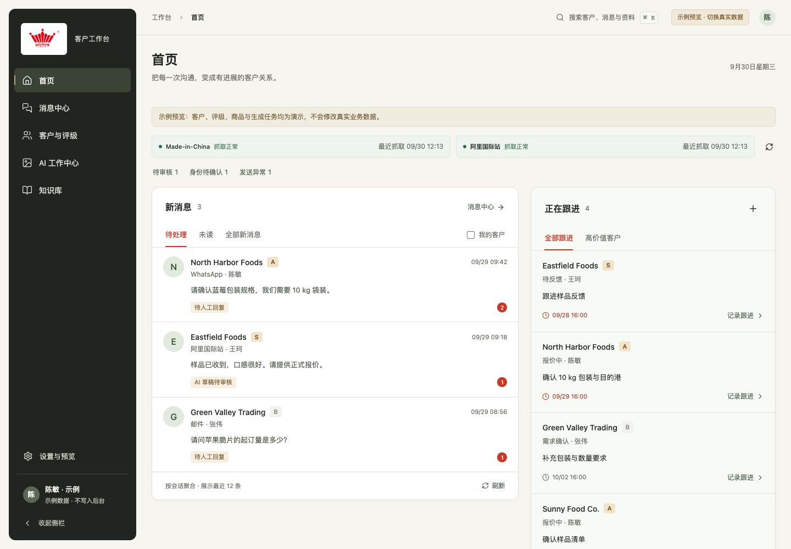
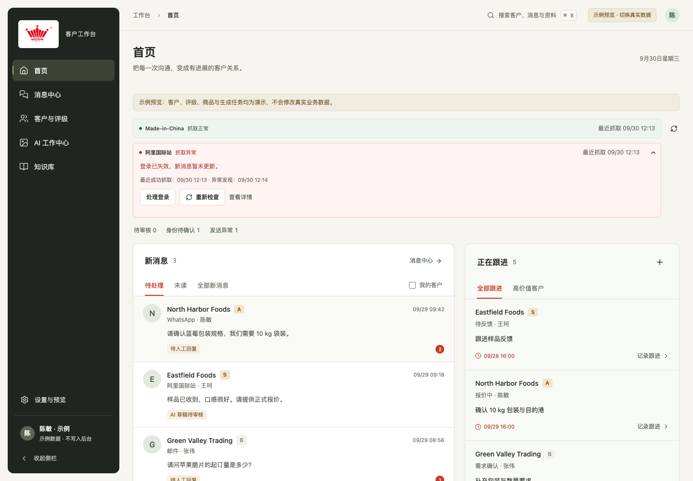

# CRM Web 1.0.0 发布交接

日期：2026-09-30。正式 Web 基线为 main，版本标签 crm-web-v1.0.0。

通过 [PR #1](https://github.com/hanmin6/fsh/pull/1) 发布；[GitHub 验证](https://github.com/hanmin6/fsh/actions/runs/36668511534) 的前端/浏览器、Spec/PHP/契约、Android 三项任务全部通过。

## 本版体验

一套 React / TypeScript 前端、一个宿主桥接、一个部署资源目录。五个入口为首页、消息中心、客户与评级、AI 工作中心、知识库。首页保留新消息与正在跟进，上方用两条小状态栏显示平台抓取，异常展开，恢复收回。

从会话内完成身份确认、新线索、人工接管、草稿修改和人工批准、知识引用、转销售与发送任务检查。客户评级保存到真实客户实体，并由服务器记录确认人、时间和依据。双平台洞察、来源证据和跟进安排直接进入同一工作台。知识库包含规格、证书、文档和附件素材；现有状态机和权限仍由服务器裁决。

HIG 的主要业务能力已经整合进 crm-web，另迁入状态接口的 ACL 裁剪和原生食品业务布局修复。完整 HIG 代码留在归档标签中，不加载第二套 React/shadcn 运行时。

## 部署

仓库已包含 `client/custom/res/workspace/workspace.js`、`workspace.css`。更新代码后在目标 EspoCRM 实例运行 metadata rebuild 并刷新浏览器；后端增加了客户评级字段，不能只复制 JS/CSS。生产部署、数据库变更和真实平台验收不属于这次 GitHub 发布，未在生产服务器执行。

本版不改变全局停发策略，不扩大共享账号的审批权限。普通账号按现有 ACL 展示操作；没有 OutboundTask.create 权限时不能批准发送。食品模块继续由原有 Feature Flag 启用；关闭或无权限时显示相应空态/提示。

开发和预览：

```bash
npm ci --prefix client/custom/ui
npm test --prefix client/custom/ui
npm run build --prefix client/custom/ui
cd client/custom/ui
npx vite --host 127.0.0.1 --port 5176
```

打开 `/preview.html?preview=1`。独立预览只使用虚构资料，真实数据模式会拒绝后台请求。测试控制页面仅供回归，不属于生产 bundle。

## 数据与服务边界

抓取状态以 CRM 收到的成功同步记录和真实执行端的最近心跳共同判断；授权连接正常不等于抓取成功。无成功记录、无执行端证据或读取失败时不标绿；心跳缺失、登录失效、验证码或长时间没有成功记录会提示异常。采集系统未报告的空轮询、完整历史、首次异常和平台原始日志不会凭空补齐；详情明确显示状态来源及本次观察记录。

图片/视频生成供应商尚未配置，真实生成按钮不会制造伪成功任务。已完成创作页面、参数、素材预览、方案选择、任务和作品入口；示例流程只保留本地原图与交互记录，没有实际视频、下载、跨设备资产存储或模型费用。后续接供应商时沿用此 UI。

知识文档接现有知识库文件索引，需要有效文件路径和已有扫描流程。消息附件如果只同步文件说明，则显示文件名、类型和大小，原文件需回来源平台；不会把未授权 URL 当下载地址。规格/证书冻结和审核由现有端点维护。销售业务按客户公司或联系人归集，Lead 需先确认成客户。

指定账号真实全历史导入、来源覆盖率、真实外发及生产登录部署仍需实际环境验收。本次仅使用独立 Docker 和虚构数据。

## 验证与版本

完整结果见 [验证记录](../specs/005-unified-crm-web/verification.md)。版本、旧分支精确 SHA 和恢复方式见 [分支索引](BRANCH_GUIDE.md)。发布前 main 及三条旧 Web UI 分支均先保留归档标签；本地活跃 worktree 的未提交内容不迁移、不删除。




